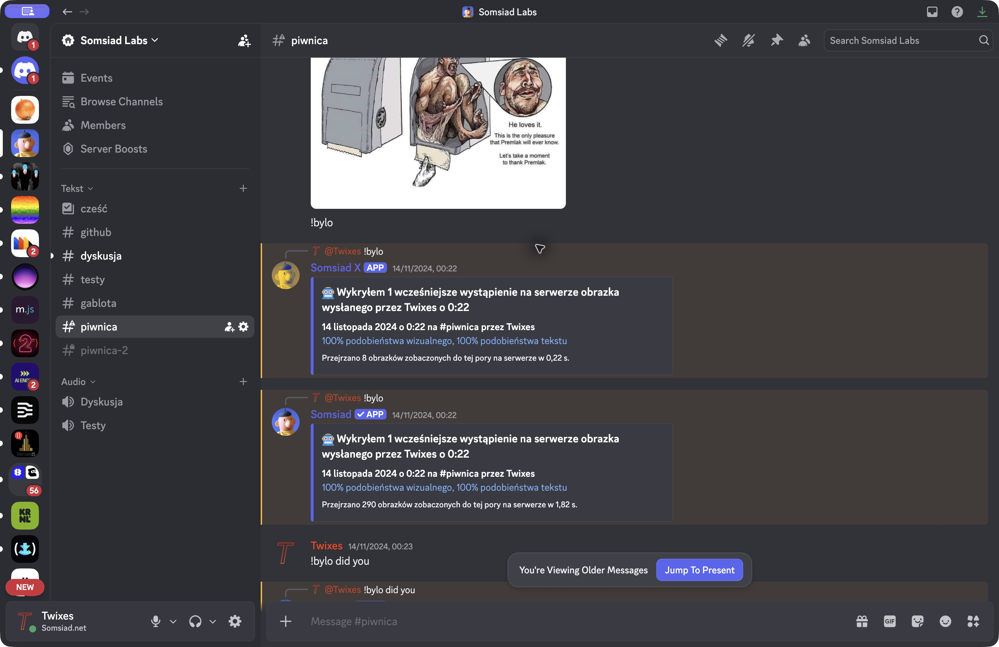
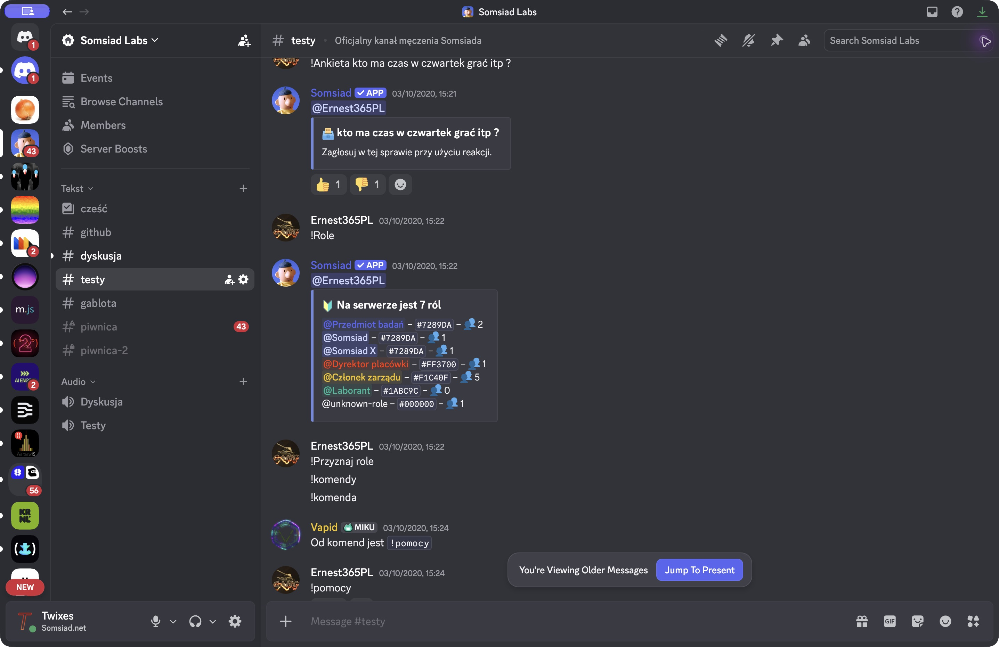
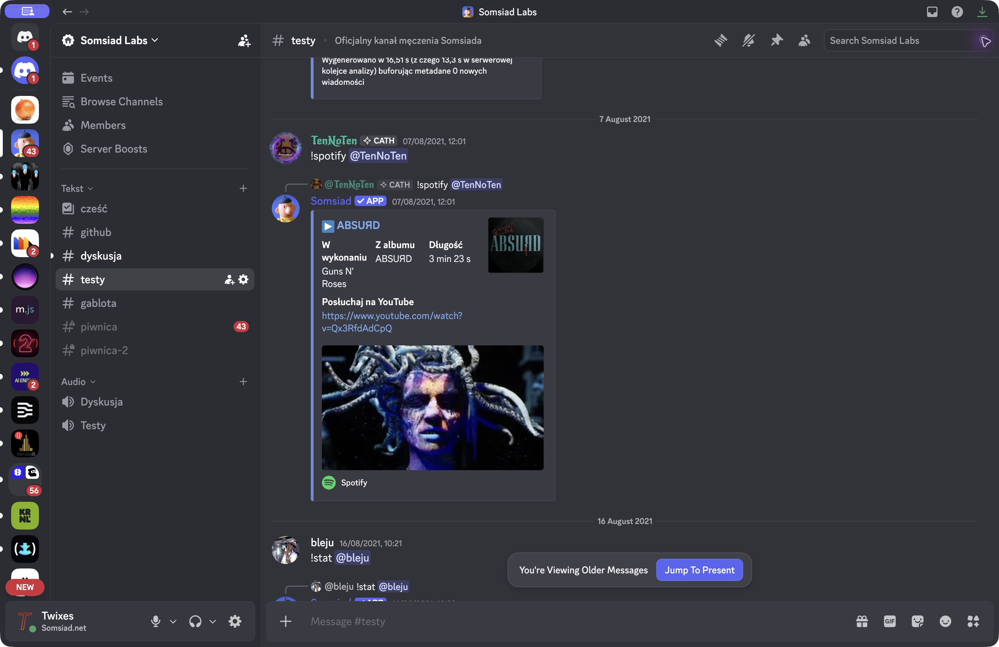

# Somsiad privileged-intent demonstrations

These original screenshots show existing Somsiad features in Discord. The dates below are the dates of the demonstrated conversations; the screenshots were captured in November 2026. They are historical examples, not newly staged demonstrations.

## Message Content: Image9000

**14 November 2024, Somsiad Labs #piwnica.** The lower response is from the verified **Somsiad** app. It reports one earlier occurrence with 100% visual and text similarity after searching 290 indexed server images. The upper response is from **Somsiad X**, a separate test bot with an eight-image index.

Image9000 indexes image attachments from ordinary server messages using local perceptual hashing and OCR. Later, users can search for earlier occurrences, visually similar images, or words extracted from images. The privileged-intent dependency is access to the ordinary image attachments used to build that index. A slash-command attachment or message context menu can provide a query image, but does not supply the earlier ordinary posts to search against. Prefix-command parsing is not the basis of the request.

Implementation: [`Imaging.on_message` and `Imaging.robot9000`](../../plugins/imaging.py).

## Guild Members: role membership counts

**3 October 2020, Somsiad Labs #testy.** The verified Somsiad app lists server roles and their member counts in response to `!Role`.

This screenshot demonstrates member-aware output. Somsiad also uses the Guild Members intent for automatic member join/leave records; those events are implemented in [`plugins/moderation.py`](../../plugins/moderation.py) and are not shown in this screenshot.

## Guild Presences: Spotify current activity

**7 August 2021, Somsiad Labs #testy.** The verified Somsiad app responds to `!spotify` with the member's current track, artist, album, duration and listening links. The current Spotify activity comes from Discord presence updates; changing the command invocation to a slash command would not supply that activity data.

Implementation: [`plugins/spotify.py`](../../plugins/spotify.py).
